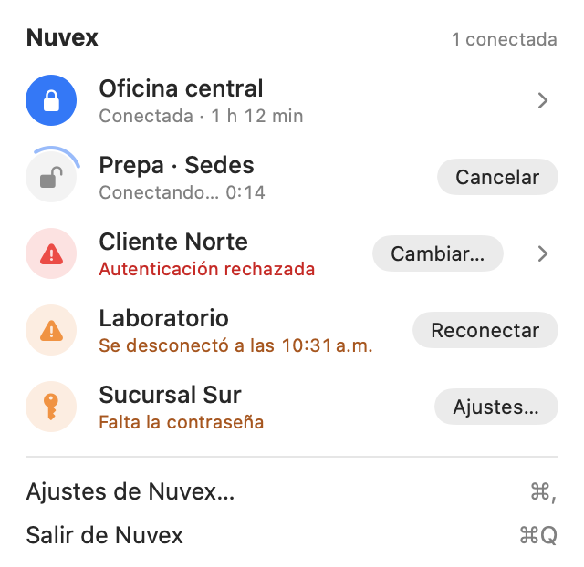
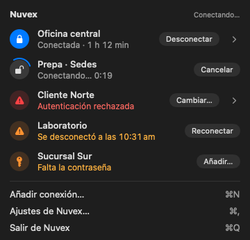
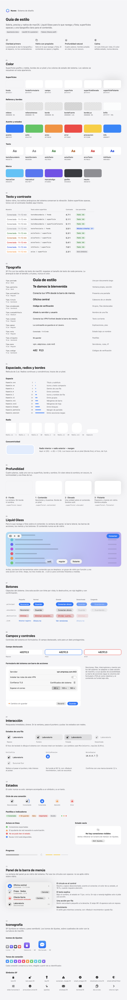
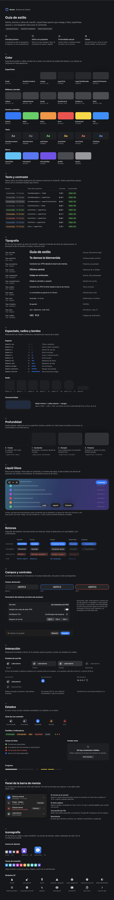

# Guía de estilo de Nuvex

Esta guía documenta el lenguaje visual de Nuvex tal como está implementado. Es la referencia para cualquier pantalla nueva: si un valor no aparece aquí, no debería aparecer en el código.

- **Tokens y componentes:** [`Nuvex/Sources/Nuvex/Diseno.swift`](Nuvex/Sources/Nuvex/Diseno.swift). Es la única fuente de colores, tipografía, espaciado, radios, materiales, sombras y movimiento.
- **Referencia visual interactiva:** [`Nuvex/Sources/Nuvex/GuiaEstilo.swift`](Nuvex/Sources/Nuvex/GuiaEstilo.swift), solo en compilaciones de depuración (ver [Cómo verla](#cómo-ver-la-referencia-visual)).
- **Capturas de referencia:** [`docs/guia-estilo/`](docs/guia-estilo/).

> Nuvex es una app nativa en SwiftUI, no una web. Los *design tokens* son constantes de Swift (`Paleta`, `Tipo`, `Espacio`, `Radio`, `Borde`, `Sombra`, `Elevacion`, `NivelVidrio`, `Movimiento`, `Tamano`) en lugar de variables CSS. Cumplen la misma función: cada valor tiene un nombre semántico y se define una sola vez.

| Claro | Oscuro |
| --- | --- |
|  |  |

## Índice

0. [Referencias y decisiones](#0-referencias-y-decisiones)
1. [Identidad visual](#1-identidad-visual)
2. [Paleta de colores](#2-paleta-de-colores)
3. [Tipografía](#3-tipografía)
4. [Espaciado y dimensiones](#4-espaciado-y-dimensiones)
5. [Bordes y geometría](#5-bordes-y-geometría)
6. [Materiales Liquid Glass](#6-materiales-liquid-glass)
7. [Profundidad y sombras](#7-profundidad-y-sombras)
8. [Componentes](#8-componentes)
9. [Estados interactivos](#9-estados-interactivos)
10. [Iconografía](#10-iconografía)
11. [Animaciones y microinteracciones](#11-animaciones-y-microinteracciones)
12. [Diseño adaptable](#12-diseño-adaptable)
13. [Accesibilidad](#13-accesibilidad)
14. [Reglas para pantallas nuevas](#14-reglas-para-pantallas-nuevas)
15. [Control de calidad visual](#15-control-de-calidad-visual)

---

## 0. Referencias y decisiones

**Referencias.** Por orden de prioridad:

1. Apple Human Interface Guidelines: *Designing for macOS*, *Materials*, *Liquid Glass*.
2. Apple Design Resources: kit de macOS 27.
3. Las skills [`macos-golden-gate-design`](https://github.com/github/awesome-copilot/blob/main/skills/macos-golden-gate-design/SKILL.md) y [`liquid-glass-skill`](https://github.com/farkasseb/liquid-glass-skill), que resumen esas guías y las API de SwiftUI.

Las páginas de Apple se cargan con JavaScript y no pudieron leerse de forma automática. Las reglas de aquí proceden de las skills, que citan la HIG y las sesiones de la WWDC, y del comportamiento real de los controles en macOS 27.

**Principios adoptados**

- La ventana es el contenedor exterior. Nada envuelve la app en un panel redondeado propio.
- **Presupuesto de tarjetas: cero.** Un contenedor con borde solo existe cuando su límite tiene significado. Secciones, listas, formularios y pasos no son tarjetas.
- Liquid Glass vive en el cromo del sistema y en los controles compactos: barra lateral, barra de herramientas, menús, el panel de la barra de menús, popovers y botones. El plano del contenido permanece tranquilo y opaco.
- **Nunca vidrio sobre vidrio.** El vidrio no puede muestrear otro vidrio.
- Solo lleva tinte la acción principal.
- La jerarquía no puede depender de la transparencia: con «Reducir transparencia» la composición debe sostenerse.

**Mapa de paneles**

| Pantalla | Estructura | Vidrio | Contenido |
| --- | --- | --- | --- |
| Panel de la barra de menús | Menú transitorio con lista de VPN | La ventana `MenuBarExtra` (del sistema) | Filas, avisos y elementos de menú, planos |
| Ajustes | `NavigationSplitView`: barra lateral + detalle | Barra lateral, barra de acciones y botones (sistema) | `Form` agrupado del sistema |
| Bienvenida, código, novedades, exportar, importar | Ventanas auxiliares | Solo los botones | Texto y controles sobre `fondo` |

**Auditoría de contenedores**

| Antes | Ahora | Motivo |
| --- | --- | --- |
| Círculos de estado de vidrio dentro del panel | Relleno opaco | Vidrio sobre vidrio |
| Barra de guardado de vidrio con botones de vidrio | Barra del sistema (`safeAreaBar`) con efecto de borde | Vidrio sobre vidrio; se usa el componente nativo |
| Avisos del panel en tarjetas tintadas | Filas en línea: símbolo en la columna de los círculos y texto | El borde no añadía información |
| Pasos de la bienvenida en tarjetas | Filas con símbolo, sin contenedor | Aspecto de panel web |
| Novedades dentro de una tarjeta | Texto entre separadores | Contenido plano |
| Resumen del guardado en una tarjeta propia | `GroupBox` nativo | Componente del sistema |
| Cápsula alrededor de «+ −» en la barra lateral | Botones sin borde | Contenedor falso |
| Logotipo en la cabecera del panel | Solo el título | Los logotipos no van en el cromo |
| Cabecera de la conexión fuera del formulario | Primera sección del formulario | Comparte márgenes y desplazamiento con Ayudante y Cuenta de Google |
| Novedades entre dos separadores | Cabecera y notas en un solo desplazamiento; «Continuar» en la barra de acciones | Menos líneas; el texto se funde bajo la barra del sistema |
| Estados vacíos del panel compuestos a mano | Componente `EstadoVacio` | Misma jerarquía en los tres casos |
| Secciones de la guía separadas por líneas | Número, título y 64 pt de aire (`Espacio.seccion`) | Aspecto editorial, sin divisores |

**Fase de pulido** (esta versión). Lo que impedía el nivel premium y cómo se resolvió:

| Problema | Decisión |
| --- | --- |
| En claro, superficie, superficie elevada y flotante eran el mismo blanco sin regla que las distinguiera | Escala `Elevacion` (base, contenido, elevado, flotante): cada plano fija a la vez superficie, borde y sombra. Nuevo `superficieFlotante` (`#313236` en oscuro) |
| Sombras cortas (r 6–18) que se leían como borde gris | Dos capas: contacto nítida y ambiental amplia (r 10–28) y más tenue |
| `textoTerciario` en claro daba 3,0:1 y se veía apagado | `#838388` (3,5:1) y `#808085` en oscuro (4,6:1): supera 3:1 en todas las superficies |
| Salto pequeño entre el título de portada y los de sección; entradillas al tamaño del cuerpo | `Tipo.portada` (26 pt) y `Tipo.entradilla` (15 pt) |
| Botón destructivo gris, igual que los demás | `estiloBoton(.destructivo)`: texto `errorTexto` con el borde del sistema |
| Pastillas con márgenes sueltos (`+ 1`) | `Tamano.pastilla` (18 pt), `puntoPastilla` y márgenes compensados ópticamente |
| Guía con aspecto de documento técnico (separadores, rótulos en mayúsculas, muestras huecas) | Portada editorial con principios, secciones numeradas sin separadores, muestras en los planos reales y texto en «Aa» |
| Capturas con los botones principales y los interruptores atenuados | Las capturas fijan `controlActiveState = .key`, como una ventana activa |

## 1. Identidad visual

**Filosofía.** Nuvex vive en la barra de menús y se usa a diario durante unos segundos. Debe sentirse como una parte de macOS: tranquila, precisa y confiable. La calidad se nota en los detalles (alineaciones, bordes de un píxel, transiciones cortas), no en la cantidad de efectos.

**Principios**

1. **Nativo primero.** Controles, formularios, menús, diálogos, la barra lateral y las barras son los del sistema. Solo se dibuja a medida lo que el sistema no ofrece: la fila de una VPN, el campo del código y los iconos de Ajustes.
2. **Composición antes que efectos.** La jerarquía la dan la alineación, el espacio, la tipografía y el peso; no los bordes ni las sombras.
3. **Vidrio para el cromo; opaco para el contenido.**
4. **El estado es lo primero.** En cada pantalla se entiende de un vistazo qué está conectado, qué falla y qué hacer.
5. **Sobriedad.** Sin neón, sin degradados llamativos y sin sombras duras. Solo la marca lleva degradado: el logotipo y los iconos de Ajustes, con el degradado del sistema.

**Identidad propia de Nuvex**

- Grafito en oscuro (`#16171A`), nunca negro puro.
- Círculos de estado al estilo del Centro de control, con el acento al conectar.
- Iconos de Ajustes en cuadrados de color con reflejo superior; cada conexión conserva su tono.
- El logotipo hexagonal en degradado cian–índigo, reservado para los momentos de marca: bienvenida, novedades, actualización y estado vacío.

## 2. Paleta de colores

Todos los colores están en `Paleta`. Los de superficie y borde se resuelven según la apariencia y se refuerzan con **Aumentar contraste**. Los de estado son los colores del sistema; los valores de las tablas son los que resuelve macOS 27.

Claro y oscuro **no son una inversión**. En claro, todas las superficies son blancas sobre la niebla `#F5F5F7` y la profundidad la dan las sombras. En oscuro la dan la luminosidad (cada plano sube unos 9 puntos: `#16171A` → `#1F2023` → `#28292D` → `#313236`) y una línea de luz en el borde superior; la sombra solo asienta el borde.

### Marca

Solo para la marca. Nunca para indicar estados.

| Token | HEX | Uso |
| --- | --- | --- |
| `Paleta.marcaCian` | `#35C5FA` | Inicio del degradado del logotipo |
| `Paleta.marcaAzul` | `#5278F7` | Centro del degradado |
| `Paleta.marcaIndigo` | `#7650EC` | Final del degradado; décimo tono de conexión |

### Superficies

| Token | Claro | Oscuro | Uso |
| --- | --- | --- | --- |
| `Paleta.fondo` | `#F5F5F7` | `#16171A` | Ventanas propias (`fondoVentana()`) |
| `Paleta.fondoFormulario` | fondo de ventana del sistema (`#FFFFFF` en macOS 27) | `#16171A` | Formularios agrupados (`formularioNuvex()`). En claro es el del sistema: las secciones ya contrastan con él |
| `Paleta.superficie` | `#FFFFFF` | `#1F2023` | Plano 1 · contenido (`.superficie(.contenido)`) |
| `Paleta.superficieElevada` | `#FFFFFF` | `#28292D` | Plano 2 · elevado; vidrio regular con «Reducir transparencia» |
| `Paleta.superficieFlotante` | `#FFFFFF` | `#313236` | Plano 3 · flotante sin vidrio; vidrio flotante con «Reducir transparencia» |
| `Paleta.campo` | `#FFFFFF` | `#FFFFFF` 6 % | Fondo del campo destacado (blanco en claro, como los campos de macOS) |
| `Paleta.relleno` | `#000000` 5 % | `#FFFFFF` 7 % | Fila bajo el puntero, fichas |
| `Paleta.rellenoIntenso` | `#000000` 9 % | `#FFFFFF` 12 % | Fila pulsada, círculo neutro, pista de progreso |

### Bordes

| Token | Claro | Oscuro | Con «Aumentar contraste» |
| --- | --- | --- | --- |
| `Paleta.borde` | `#000000` 8 % | `#FFFFFF` 9 % | ×2,5 |
| `Paleta.bordeFuerte` | `#000000` 14 % | `#FFFFFF` 16 % | ×2 |
| `Paleta.bordeLuz` | `#000000` 8 % | `#FFFFFF` 14 % | ×2 |
| `Paleta.brillo` | `#FFFFFF` 70 % | `#FFFFFF` 18 % | — |

- `bordeLuz` es el borde superior de una superficie elevada. En oscuro es una línea de luz que la separa del fondo; en claro coincide con `borde`.
- `brillo` es el reflejo del vidrio de respaldo (macOS 14 y 15).

### Acento y estados (símbolos, indicadores, rellenos)

| Token | Claro | Oscuro | Significado |
| --- | --- | --- | --- |
| `Paleta.acento` | Acento del sistema (`#007AFF` por omisión) | Acento del sistema | Acción principal, conectado, foco, selección |
| `Paleta.exito` | `#34C759` | `#30D158` | Conectada, guardado, verificado |
| `Paleta.aviso` | `#FF8D28` | `#FF9230` | Requiere atención |
| `Paleta.error` | `#FF383C` | `#FF4245` | Falló |
| `Paleta.precaucion` | `#FFCC00` | `#FFD600` | Intermedio (fuerza «aceptable» de una frase) |
| `Paleta.info` | `#0088FF` | `#0091FF` | Información programada |

Estos colores **no se usan para texto** en claro: el naranja da 2,3:1 sobre blanco.

### Texto

Sobre **vidrio** (panel de la barra de menús, barra lateral), el texto usa los estilos jerárquicos del sistema (`.primary`, `.secondary`) para conservar la vibración. Sobre **superficies opacas** (formularios y ventanas) usa estos tonos, con el contraste medido en la referencia visual:

| Token | Claro | Oscuro | Contraste (claro / oscuro) | Uso |
| --- | --- | --- | --- | --- |
| `.primary` | — | — | — | Títulos, nombres, valores |
| `Paleta.textoSecundario` | `#6E6E73` | `#A1A1A6` | 4,7:1 / 7,0:1 sobre `fondo`; 5,0:1 en oscuro sobre `superficieFlotante` | Descripciones, pies de sección, metadatos |
| `Paleta.textoTerciario` | `#838388` | `#808085` | 3,5:1 / 4,6:1 sobre `fondo` | Solo lo que repite algo visible: atajos, números de sección, «Sin cambios». Nunca información nueva |
| `Paleta.exitoTexto` | `#1E7B34` | `#30DB5B` | 5,3:1 / 8,9:1 sobre `superficie` | Texto de éxito |
| `Paleta.avisoTexto` | `#B25000` | `#FFB340` | 5,2:1 / 9,1:1 | Texto de atención |
| `Paleta.errorTexto` | `#D70015` | `#FF6961` | 5,4:1 / 5,8:1 | Texto de error |
| `Paleta.infoTexto` | `#0040DD` | `#409CFF` | 7,6:1 / 5,8:1 | Texto informativo |

`Paleta.texto(color)` devuelve el tono legible de un color de estado. Lo usan `Pastilla` y las cabeceras. El naranja legible en claro (`#B25000`) se eligió más pardo que el de alto contraste de Apple (`#C93400`) para que no se confunda con el rojo de error.

### Iconos y conexiones

| Token | Claro | Oscuro | Uso |
| --- | --- | --- | --- |
| `Paleta.neutro` | `#8E8E93` | `#98989D` | General, Actualización, pastilla neutra |
| `Paleta.grafito` | `#3A3B40` | `#4A4B50` | Automatización |
| `Paleta.iconoAyudante` | índigo del sistema | índigo del sistema | Ayudante de red |
| `Paleta.iconoCorreo` | rojo del sistema | rojo del sistema | Cuenta de Google |
| `Paleta.conexiones` | azul, verde azulado, índigo, morado, rosa, naranja, verde, cian, menta y `marcaIndigo` | | Tono estable por conexión (`ColorConexion.para(id)`) |

## 3. Tipografía

SF Pro, mediante los estilos de texto del sistema (`Tipo`). Respetan el tamaño de texto de macOS. Ningún tamaño de letra se escribe a mano, salvo el de un símbolo dentro de una forma fija.

| Token | Estilo base | Tamaño | Interlineado | Peso | Uso |
| --- | --- | --- | --- | --- | --- |
| `Tipo.portada` | `.largeTitle` | 26 pt | 32 pt | Bold | Portada de un documento largo (la guía). Una por página |
| `Tipo.pantalla` | `.title` | 22 pt | 26 pt | Bold | Título de una pantalla completa (bienvenida, novedades) y de las secciones de la guía |
| `Tipo.entradilla` | `.title3` | 15 pt | 20 pt | Regular | Una o dos frases bajo el título de una pantalla, siempre en `textoSecundario` |
| `Tipo.titulo` | `.title2` | 17 pt | 22 pt | Semibold | Cabecera de un detalle (conexión, Ayudante, Cuenta de Google, actualización) |
| `Tipo.encabezado` | `.headline` | 13 pt | 16 pt | Bold | Título del panel y de diálogos; secciones de notas |
| `Tipo.cuerpoEnfasis` | `.body` | 13 pt | 16 pt | Medium | Nombre de una conexión, título de un paso |
| `Tipo.cuerpo` | `.body` | 13 pt | 16 pt | Regular | Texto general |
| `Tipo.apoyo` | `.callout` | 12 pt | 15 pt | Regular | Explicaciones, detalle de un paso, barra de acciones |
| `Tipo.nota` | `.caption` | 10 pt | 13 pt | Regular | Estado de una fila, subtítulos |
| `Tipo.etiqueta` | `.caption2` | 10 pt | 13 pt | Semibold | Pastillas, rótulos en mayúsculas |
| `Tipo.mono` / `Tipo.monoNota` | `.body` / `.caption` monoespaciada | 13 / 10 pt | 16 / 13 pt | Regular | Servidores, comandos, huellas |
| `Tipo.codigo` | `.title2` monoespaciada | 17 pt | 22 pt | Semibold | Código de verificación |
| `Tipo.simboloVacio` | `.title2` | 17 pt | — | — | Símbolo de un estado vacío |

**Jerarquía.**
- Una vista tiene como máximo tres niveles: título, cuerpo y notas. La entradilla pertenece al título.
- Escala de contraste por niveles: portada 26 → pantalla 22 → título 17 → cuerpo 13 → nota 10. Cada salto es de al menos 4 pt o un cambio de peso; dos niveles contiguos nunca se distinguen solo por el color.
- Los metadatos técnicos (tokens, hex, rutas) van en `Tipo.monoNota` y `textoSecundario`: se leen como etiqueta, no como texto.
- La cabecera de un detalle (17 pt semibold) domina sobre las etiquetas del formulario (13 pt) sin competir con el título de la ventana.
- Los números que cambian (cronómetro, duraciones, bytes, códigos) usan `.monospacedDigit()`.

## 4. Espaciado y dimensiones

Retícula de 2 pt (`Espacio`):

| Token | Valor | Uso típico |
| --- | --- | --- |
| `Espacio.xxs` | 2 | Título–subtítulo |
| `Espacio.xs` | 4 | Margen vertical de un aviso del panel |
| `Espacio.s` | 6 | Margen exterior del panel; indicador–texto |
| `Espacio.m` | 8 | Margen interior de filas y elementos de menú |
| `Espacio.l` | 12 | Columna de círculos–texto; icono–texto en cabeceras |
| `Espacio.xl` | 16 | Separación entre bloques y entre los pasos de la bienvenida |
| `Espacio.xxl` | 20 | Margen horizontal de la barra de acciones (= margen de las secciones del formulario) |
| `Espacio.xxxl` | 24 | Margen lateral de diálogos |
| `Espacio.bloque` | 32 | Margen superior de diálogos; columna de símbolos de la bienvenida |
| `Espacio.pantalla` | 40 | Margen de pantallas completas |
| `Espacio.seccion` | 64 | Entre secciones de una página larga; sustituye al separador |

**Alineaciones verificadas**

- **Panel:** el margen exterior `s` más el margen de fila `m` suman 14 pt. El título, los círculos, los símbolos de los avisos y los elementos de menú comparten ese borde izquierdo. El texto de los avisos se alinea con los nombres: `m + circuloEstado + l`.
- **Ajustes:** la cabecera de la conexión es la primera sección del formulario, así que su icono se alinea con el texto de las secciones. Los extremos de la barra de acciones coinciden con los bordes de las secciones. Esto se cumple hasta los 704 pt de `columnaFormulario` (con margen `xxl`) y también cuando el formulario se centra en ventanas anchas.
- **Bienvenida:** los símbolos de los pasos ocupan una columna de 32 pt y los textos comparten el mismo borde izquierdo.

### Tamaños de componentes (`Tamano`)

| Token | Valor | Uso |
| --- | --- | --- |
| `Tamano.panel` | 320 | Ancho del panel |
| `Tamano.codigoAnchoIdeal` / `codigoAnchoMinimo` | 360 / 300 | Ventana del código: ancho normal y mínimo en pantallas estrechas |
| `Tamano.codigoAltoIdeal` / `codigoAltoMinimo` / `codigoAltoMaximo` | 340 / 280 / 560 | Inicia a 340 pt, solo se reduce si la pantalla no permite los márgenes y admite redimensionarse hasta 560 pt; el contenido se desplaza si hace falta |
| `Tamano.columnaFormulario` | 704 | Ancho máximo de las secciones de un `Form` agrupado en macOS 27 (medido). La barra de acciones usa la misma columna |
| `Tamano.filaPanel` | 40 | Alto mínimo de una fila del panel |
| `Tamano.circuloEstado` | 28 | Círculo de cada VPN; columna de símbolos de los avisos |
| `Tamano.iconoLista` | 22 | Icono de la barra lateral y de listas |
| `Tamano.iconoCabecera` | 40 | Icono de la cabecera de un detalle |
| `Tamano.iconoDestacado` | 52 | Icono de un diálogo (código) |
| `Tamano.logoTarjeta` / `logoPantalla` | 56 / 72 | Logotipo en la actualización / en pantallas completas |
| `Tamano.indicador` | 7 | Punto de estado |
| `Tamano.pastilla` / `puntoPastilla` | 18 / 6 | Alto mínimo de una pastilla y su punto |
| `Tamano.botonIcono` | 18 | Área de un botón de solo icono sin borde (copiar) |
| `Tamano.simboloPequeno` / `simboloCirculo` / `simboloDestacado` | 10 / 12 / 44 | Chevron, símbolo del círculo, símbolo de resultado |

Ventanas: bienvenida, 460 pt de ancho; código, 360 × 420 ideal con rango 300 × 280–560 y límites del `visibleFrame`; novedades, 480 × 540; exportar, 520 × 600; importar, 540 × 560; Ajustes, mínimo 780 × 580. La ventana del código usa nivel normal para no cubrir menús, se centra en la pantalla activa, escalona solicitudes simultáneas y vuelve a ajustarse al cambiar de monitor.

## 5. Bordes y geometría

Todas las esquinas son continuas (`RoundedRectangle.nuvex(_:)`).

| Token | Valor | Uso |
| --- | --- | --- |
| `Radio.xs` | 4 | Barras pequeñas |
| `Radio.s` | 6 | Elementos de menú (alto ≤ 24 pt) |
| `Radio.m` | 10 | Filas del panel, campo destacado (alto 28–44 pt) |
| `Radio.l` | 14 | Superficies (`.superficie`) y muestras |
| `Radio.xl` | 20 | Contenedores grandes (reservado) |
| `Radio.xxl` | 26 | Hojas propias (reservado) |
| `Radio.icono(lado)` | lado × 0,2237 | Iconos cuadrados, en la proporción de los iconos de macOS |
| `Capsule()` | — | Botones y pastillas |

- **Concentricidad:** radio interior = radio exterior − margen. Si unas esquinas anidadas se ven pellizcadas o abiertas, la interior no es concéntrica.
- **Grosores (`Borde`):** `fino` 0,5 pt (un píxel en Retina), `regular` 1 pt (campo con foco o error), `foco` 3 pt (halo del campo destacado).
- **Trazo de las superficies:** centrado (`stroke`), no `strokeBorder`. Con radios grandes, la forma interior continua deja muescas de un píxel en los lados.

## 6. Materiales Liquid Glass

**Mapa de vidrio de Nuvex**

| Superficie | Material | Lo aporta |
| --- | --- | --- |
| Ventana del panel de la barra de menús | Liquid Glass | macOS (`MenuBarExtra` `.window`) |
| Barra lateral de Ajustes | Liquid Glass (grande, no cambia de claro a oscuro) | macOS (`NavigationSplitView`) |
| Barra de acciones de una conexión | Efecto de borde de desplazamiento | macOS (`safeAreaBar`, a través de `.barraAcciones`) |
| Botones | `.glassProminent` (principal) / `.glass` | macOS (`estiloBoton`) |
| Menús, popovers, diálogos | Liquid Glass | macOS |
| Filas, círculos, avisos, formularios, textos | **Opacos** | — |

`.vidrio(_:en:tinte:interactivo:respaldo:)` existe solo para un **control flotante a medida** que el sistema no ofrezca. Hoy ninguna pantalla lo necesita; la referencia visual lo muestra como especificación.

| Nivel | macOS 26+ | Respaldo en 14–15 | Sombra |
| --- | --- | --- | --- |
| `.sutil` | Glass regular | `.ultraThinMaterial` + borde con `brillo` | ninguna |
| `.regular` | Glass regular | `.thinMaterial` + borde con `brillo` | `sutil` |
| `.flotante` | Glass regular | `.regularMaterial` + borde con `brillo` | `flotante` |

**Reglas de uso**

- Nunca vidrio sobre vidrio. Dentro de una superficie de vidrio, los controles son opacos (los círculos del panel) o botones del sistema.
- Varios vidrios cercanos van en un solo `.grupoVidrio()`.
- El tinte se reserva para la acción principal o un elemento con función distinta, y usa colores del sistema.
- No se usa la variante `clear`: Nuvex no pone vidrio sobre fotografías ni vídeo.
- No se fuerzan fondos propios en barras o barras de herramientas: bloquean el vidrio y el efecto de borde.
- En macOS el vidrio se atenúa cuando la ventana pierde el foco. Es el comportamiento esperado, no un fallo.

## 7. Profundidad y sombras

La profundidad es una escala de cuatro planos (`Elevacion`). Cada plano fija **a la vez** su superficie, su borde y su sombra, para que nunca se combinen por separado:

```swift
resumen.superficie(.elevado)               // superficieElevada + línea de luz + Sombra.sutil
popoverPropio.superficie(.flotante, radio: Radio.xl)
```

| Plano | Superficie | Borde | Sombra | Ejemplo |
| --- | --- | --- | --- | --- |
| 0 · `base` | `fondo` `#F5F5F7` / `#16171A` | ninguno | ninguna | Ventanas propias (`fondoVentana()`) |
| 1 · `contenido` | `superficie` `#FFFFFF` / `#1F2023` | `borde` | ninguna | Muestras, estado vacío fuera de una lista. Las secciones de un `Form` son el plano 1 del sistema |
| 2 · `elevado` | `superficieElevada` `#FFFFFF` / `#28292D` | `bordeLuz` → `borde` | `sutil` | Una unidad que se lee sola sobre el contenido; `GroupBox` es su equivalente nativo |
| 3 · `flotante` | `superficieFlotante` `#FFFFFF` / `#313236` | `bordeLuz` → `borde` | `flotante` | Respaldo opaco de lo que flota. Lo normal es el vidrio del sistema (barras, menús, panel) |

**Criterios.**
- Sube un plano solo si el elemento se mueve o se lee por encima de lo que tiene debajo. Agrupar no es elevar: para agrupar basta el espacio.
- Un plano nunca contiene otro plano más alto que él mismo más uno.
- El vidrio no forma parte de esta escala: es el material de lo que navega o flota (sección 6).

`.sombra(_:)` usa dos capas, como la luz real: una de contacto corta y nítida que asienta el borde, y una ambiental amplia y muy tenue que da la altura. En oscuro, la opacidad se multiplica por 3.

| Nivel | Contacto | Ambiental | Uso |
| --- | --- | --- | --- |
| `Sombra.sutil` | negro 5 %, r 1, y 0,5 | negro 5 %, r 10, y 3 | Plano elevado, vidrio regular |
| `Sombra.media` | negro 5 %, r 1, y 0,5 | negro 8 %, r 18, y 6 | Reservado |
| `Sombra.flotante` | negro 6 %, r 1,5, y 1 | negro 10 %, r 28, y 12 | Plano flotante, vidrio flotante a medida |

## 8. Componentes

### Botones

```swift
Button("Guardar", action: guardar)
    .estiloBoton(.principal)             // cápsula con tinte (glassProminent)
    .keyboardShortcut("s", modifiers: .command)

Button("Revertir", action: revertir)
    .estiloBoton(.secundario)            // cápsula neutra (glass)

Button("Ahora no", action: cerrar)
    .buttonStyle(.link)

Button("Eliminar conexión…", role: .destructive, action: eliminar)
    .estiloBoton(.destructivo)           // texto rojo legible, borde del sistema
```

| Variante | Cuándo | Reglas |
| --- | --- | --- |
| `.principal` | La acción que completa la vista | Una por vista; `.keyboardShortcut(.defaultAction)` si es la acción por omisión |
| `.secundario` | Alternativas y acciones de fila | — |
| `.link` | Salir, ver más, abrir el registro | Nunca para cambiar datos |
| `.destructivo` | Eliminar, olvidar | `role: .destructive`, confirmación previa y nunca la acción por omisión. Usa el botón con borde del sistema (el de sus vecinos en un formulario) con el texto en `errorTexto`; el sistema añade un fondo rojo muy tenue |
| Icono (`.borderless`) | «+ −», «⋯», copiar | `.help` y `.accessibilityLabel` obligatorios |

Tamaños: `.small` en el panel, normal en formularios, `.large` en diálogos.

### Barra de acciones

```swift
formulario
    .barraAcciones {
        HStack { mensaje; Spacer(); revertir; guardar }
    }
```

En macOS 26 o posterior es `safeAreaBar(edge: .bottom)`: el formulario se desvanece bajo la barra y los botones son el único vidrio. En macOS 14 y 15 es una barra con `.bar` y un separador.

### Campos

- En formularios: `TextField`/`SecureField` del sistema, con `prompt:` de ejemplo.
- Campo destacado (un solo dato protagonista): `.campoDestacado(enfocado:error:)`.
  - En reposo: fondo `campo` y borde `bordeFuerte`.
  - Con foco: borde de acento de 1 pt y halo de 3 pt al 28 %.
  - Con error: lo mismo en `error`.
- La validación va debajo del campo, con un `Label` en `Paleta.avisoTexto`, y solo después de escribir o de intentar guardar.

### Selects, interruptores y segmentos

`Picker` (menú), `Toggle` (interruptor) y `Picker` segmentado del sistema, dentro de un `Form`. No se personalizan: macOS los convierte en vidrio al interactuar.

### Formularios

```swift
Form {
    Section { cabecera }                       // icono + título + estado + acción
    Section { … } header: { Text("Cuenta") } footer: {
        Text("…").foregroundStyle(Paleta.textoSecundario)
    }
}
.formularioNuvex()
```

### Avisos en línea

Sin contenedor: el símbolo de estado y el texto. En el panel, el símbolo ocupa la columna de los círculos y el texto se alinea con los nombres; la acción, si la hay, es un botón secundario pequeño.

```swift
Label {
    Text("No se pudo leer el estado.").foregroundStyle(Paleta.errorTexto)
} icon: {
    Image(systemName: "xmark.octagon.fill").foregroundStyle(Paleta.error)
}
```

### Agrupar un resumen

`GroupBox` del sistema; por ejemplo, el resultado del guardado en la bienvenida. `.superficie(_:)` solo para muestras y casos en que el límite sea información.

### Onboarding de automatización

La preparación de agentes expone una sola acción principal, **Configurar**. Ese
consentimiento instala o actualiza los componentes gestionados, crea reglas
acotadas y revocables, activa el inicio con la sesión y ejecuta el diagnóstico.
Los detalles técnicos se resumen por agente como **Listo** o con el único paso
pendiente. Nunca se presentan instalación, autorización y comprobación como
acciones consecutivas que la persona deba descubrir por separado.

### Estados vacíos

`EstadoVacio` ocupa el lugar de una lista vacía o que no se pudo leer: icono, título en `Tipo.encabezado`, explicación en `Tipo.apoyo` y `textoSecundario` y, como mucho, una acción pequeña. Centrado y sin contenedor.

```swift
EstadoVacio("No hay conexiones visibles",
            detalle: "Activa «Mostrar en la barra de menús» en Ajustes.", simbolo: "eye.slash") {
    Button("Abrir Ajustes…") { abrirAjustes() }.estiloBoton(.secundario)
}
```

El símbolo es jerárquico y secundario; solo el estado «sin conexiones» usa el logotipo, porque es un momento de marca. La acción es principal solo si es el único camino posible (añadir la primera conexión).

### Pastillas e indicadores

```swift
Pastilla(texto: "Beta", color: Paleta.aviso)                    // texto en avisoTexto
Pastilla(texto: "Conectada", color: Paleta.exito, conIndicador: true)
Indicador(color: Paleta.exito)                                   // 7 pt; anima el cambio de color
```

La pastilla mide 18 pt de alto, con fondo del color al 14 % y texto en su tono legible. Con punto, el margen izquierdo baja de 8 a 6 pt: el lado curvo pesa menos y así el conjunto queda centrado a la vista. VoiceOver la lee como un solo elemento.

### Iconos cuadrados

```swift
IconoCuadrado(simbolo: "lock.fill", color: ColorConexion.para(perfil.id))            // 22 pt
IconoCuadrado(simbolo: "shield.lefthalf.filled", color: Paleta.iconoAyudante,
              lado: Tamano.iconoCabecera)                                            // 40 pt
```

### Fila de VPN (panel)

`FilaVPN` tiene:
- un círculo opaco de 28 pt: `rellenoIntenso` en neutro, acento al conectar y el color del estado al 16 % cuando requiere atención;
- el nombre en `cuerpoEnfasis` y el estado en `nota` con cifras tabulares;
- un accesorio a la derecha: botón secundario pequeño, chevron o el atajo `⌘1…⌘9`.

Cuando está desconectada, toda la fila es un botón con `EstiloFila`. En los demás estados, el círculo es un botón con `EstiloPresion`.

### Navegación

- **Barra lateral:** `List` con `.listStyle(.sidebar)`, iconos cuadrados de 22 pt y, al pie, «+ −» y «⋯» como botones sin borde.
- **Elementos de menú del panel:** `ElementoMenu`, con resaltado de acento en `Radio.s` y atajo alineado a la derecha.

### Diálogos, menús, popovers y tooltips

- Confirmaciones con `confirmationDialog`: el título es una pregunta y el mensaje explica la consecuencia.
- Las ventanas propias usan `fondoVentana()` y siguen el orden icono o logotipo, título, contenido y botones al pie (`.large`, el principal a la derecha).
- Menús, popovers y tooltips (`.help`) son los del sistema.

### Copiar

`BotonCopiar(texto:etiqueta:)`: el icono cambia a una marca verde durante 1,2 s con una transición del símbolo.

## 9. Estados interactivos

| Estado | Tratamiento |
| --- | --- |
| **Hover** | Filas del panel: `relleno` en `Radio.m` (`EstiloFila`, animación `rapida`). Elementos de menú: acento con texto blanco. Botones del sistema: su propio brillo |
| **Active / pulsado** | `EstiloFila`: `rellenoIntenso`. `EstiloPresion`: escala 0,92 y −6 % de brillo (solo brillo con «Reducir movimiento»). Botones del sistema: compresión del vidrio |
| **Focus** | Anillo del sistema con «Acceso total con teclado». Campo destacado: borde y halo de acento |
| **Seleccionado** | Selección del sistema en la barra lateral |
| **Disabled** | Controles del sistema: atenuación nativa. `EstiloFila`: 45 %. `EstiloPresion`: 50 %. El motivo se explica con `.help` |
| **Loading** | `ProgressView` pequeño y un texto en gerundio; el botón que lo inició queda desactivado |
| **Error** | Símbolo en `error` y texto en `errorTexto`, seleccionable |
| **Success** | Símbolo en `exito` y confirmación en `exitoTexto` o `textoSecundario` |
| **Atención** | Símbolo en `aviso` y texto en `avisoTexto`, con la acción que lo resuelve |

| Situación de una VPN | Símbolo | Círculo | Texto |
| --- | --- | --- | --- |
| Conectada | `lock.fill` blanco | Acento | `Conectada · 1 h 12 min` |
| Conectando | `lock.open.fill` | `rellenoIntenso` + anillo de acento | `Conectando… 0:14` |
| Desconectada | `lock.open.fill` | `rellenoIntenso` | `Desconectada` |
| Se desconectó o falta un dato | triángulo, `key.fill`, `slider.horizontal.3` en `aviso` | `aviso` al 16 % | En `avisoTexto` |
| Error | triángulo en `error` | `error` al 16 % | En `errorTexto` |

## 10. Iconografía

- **SF Symbols** en variante rellena para estados y objetos, y en contorno para acciones de utilidad (`doc.on.doc`, `chevron.right`).
- **Peso:** semibold dentro de formas; junto a texto, el del texto.
- **Tamaños:** junto a texto, heredan el estilo. Dentro de formas fijas: 10 pt (chevron), 12 pt (círculo), 50 % del lado (iconos cuadrados) y 44 pt (resultado).
- **Renderizado:** monocromo; `.hierarchical` en los símbolos grandes de resultado.
- **Bienvenida:** `server.rack`, `lock.shield` y `menubar.arrow.up.rectangle` en el acento, a `Tipo.titulo`.
- **Logotipo:** `LogoNuvex` aparece solo en bienvenida, novedades, actualización, el estado vacío del panel y la portada de la guía. Nunca en barras ni cabeceras.

## 11. Animaciones y microinteracciones

| Token | Curva y duración | Uso |
| --- | --- | --- |
| `Movimiento.rapida` | `snappy`, 0,18 s | Hover, pulsación, foco |
| `Movimiento.estandar` | `snappy`, 0,25 s | Detalles, cambios de estado, barra de acciones, color del indicador y del círculo |
| `Movimiento.suave` | `smooth`, 0,35 s | Cambio de paso en la bienvenida |
| `Movimiento.reducida` | `easeInOut`, 0,15 s | Sustituye a las anteriores con «Reducir movimiento» |
| `Movimiento.aparicion(reducir:)` | Fundido con un desplazamiento de 4 pt; solo fundido con «Reducir movimiento» | Detalles de una fila |

- Usa `.animacion(_:value:)` en lugar de `.animation(_:value:)`, porque respeta «Reducir movimiento».
- Los símbolos que cambian lo hacen con `.contentTransition(.symbolEffect(.replace))`.
- El mensaje de la barra de acciones cambia con `.contentTransition(.opacity)`.
- El anillo de «Conectando» gira a 0,9 s por vuelta; con «Reducir movimiento» se muestra completo y estático.
- Nada se anima en bucle salvo un progreso real, y ninguna animación retrasa una acción.

## 12. Diseño adaptable

- **Panel:** 320 pt de ancho; con más de 8 conexiones, la lista se desplaza dentro de 8 filas de alto.
- **Ajustes:** barra lateral de 210–300 pt y detalle flexible; mínimo 780 × 580. Revisado a 780 × 580, 820 × 640 y 1180 × 820. Las secciones crecen hasta 704 pt y después se centran; la barra de acciones sigue la misma columna.
- **Diálogos:** ancho fijo y alto según el contenido. La ventana del código inicia compacta a 360 × 340 pt y permanece en el nivel flotante estándar mientras la operación esté activa; los textos largos envuelven (`.fixedSize(horizontal: false, vertical: true)`).
- **Truncado:** nombres y servidores en una línea; valores técnicos largos con truncado central.
- **Versiones:** macOS 14 o posterior. Las API de macOS 26 (vidrio, `safeAreaBar`, botones de vidrio) se comprueban solo en `Diseno.swift`, con respaldo en 14 y 15.

## 13. Accesibilidad

- **Contraste:** todo texto informativo sobre superficies opacas supera 4,5:1 en ambas apariencias; lo mide la sección «Texto y contraste» de la referencia visual. `textoTerciario` y los colores de estado base solo se usan para elementos que no se leen como información.
- **Aumentar contraste:** bordes y rellenos multiplican su opacidad; los colores del sistema usan su variante de alto contraste.
- **El color nunca va solo:** todo estado lleva símbolo y texto.
- **Teclado:** `⌘1…⌘9` conectan; `⌘,` abre Ajustes; `⌘S` guarda; `Return` y `Esc` activan la acción por omisión y la de cancelar. El campo del código recibe el foco al abrirse. Con «Acceso total con teclado», los botones y las filas reciben el anillo de foco del sistema.
- **VoiceOver:**
  - los botones de solo icono tienen `.accessibilityLabel`, y los iconos decorativos se ocultan;
  - cada fila de VPN expone su nombre y su estado;
  - cada paso de la bienvenida se lee como «Paso n: título. detalle».
- **Reducir movimiento:** `.animacion`, `Movimiento.aparicion` y `EstiloPresion` cambian a fundidos.
- **Reducir transparencia:** el vidrio del sistema se vuelve más opaco; el de respaldo usa `superficieElevada` o `superficieFlotante` según su nivel. El contenido ya es opaco, así que la jerarquía no cambia.

## 14. Reglas para pantallas nuevas

1. Antes de dibujar, escribe el mapa de paneles: qué es navegación, qué es contenido y qué es transitorio.
2. **Presupuesto de tarjetas: cero.** Antes de añadir un rectángulo, pregúntate si quitarle relleno, borde, sombra y radio cambiaría la información. Si no, quítalo.
3. Usa componentes nativos (`Form`, `List`, `GroupBox`, `Picker`, `Toggle`, barras y menús). Dibuja a medida solo lo que no existe.
4. Vidrio solo a través de componentes del sistema; `.vidrio` solo para un control flotante a medida. Nunca vidrio sobre vidrio ni vidrio en filas o tarjetas.
5. Usa los valores de `Diseno.swift`; la profundidad, solo con `.superficie(_:)`. Prohibido en las vistas: colores literales, tamaños de letra fuera de símbolos en formas fijas, radios y márgenes numéricos, `.buttonStyle(.borderedProminent)`, `.formStyle(.grouped)` y `glassEffect` directos.
6. Texto sobre superficies opacas: `textoSecundario` y los tonos `*Texto`. Sobre vidrio: estilos jerárquicos.
7. Una sola acción con tinte por vista.
8. Define todos los estados: default, hover, pressed, focus, disabled, loading, error, success y atención.
9. Escribe en español neutro, en segunda persona, con botones que dicen lo que hacen.

## 15. Control de calidad visual

Antes de dar por terminada una pantalla:

1. `bash Nuvex/scripts/capturas.sh` y revisa **ambas apariencias** de las pantallas reales, no solo la referencia. Incluye Ajustes a 780 × 580 y 1180 × 820.
2. Comprueba alineaciones (bordes izquierdos compartidos), márgenes de la retícula, radios concéntricos y jerarquía tipográfica.
3. Abre la referencia visual (`--guia-estilo`) y verifica sobre la ventana real el vidrio, el hover, la pulsación, el desactivado, la barra de acciones y la confirmación de copiar. En las capturas, el vidrio se dibuja con su respaldo porque se renderizan fuera de pantalla.
4. Revisa «Texto y contraste»: ninguna fila informativa por debajo de AA.
5. Repite con la ventana inactiva y con «Reducir transparencia», «Aumentar contraste» y «Reducir movimiento».
6. Ejecuta las pruebas del repositorio: ningún cambio visual debe alterar el comportamiento.
7. Haz una segunda pasada y corrige lo que encuentres.

**Registro de revisiones.**

- *Refinamiento anterior:* el naranja legible se confundía con el rojo; `exitoTexto` en claro daba 4,4:1; la tabla tipográfica estaba desactualizada; un token sin uso; un anillo de foco propio duplicaba el del sistema; la barra de acciones no seguía la columna centrada en ventanas anchas.
- *Fase de pulido, primera pasada:* `strokeBorder` dejaba muescas en radios grandes (ahora trazo centrado); la sombra flotante dibujaba un halo gris en claro (r 32 → 28, 12 % → 10 %); los botones principales salían grises en las capturas (ventana inactiva); un texto con marcado se mostraba con las comillas invertidas; «16 %» se partía entre dos líneas (espacio duro); una columna de la tabla tipográfica se truncaba.
- *Fase de pulido, segunda pasada (incluida la ventana real):* la sombra amplia del plano flotante oscurecía la muestra vecina (orden de dibujo y plano flotante al final de la fila); las muestras de radio grande sobre un lado corto dejaban marcas en los lados (muestras cuadradas, cápsula circular); el detalle de `EstadoVacio` a 10 pt se leía débil (ahora `Tipo.apoyo`).

**Límites conocidos de las capturas.** Se dibujan fuera de pantalla: el vidrio usa su respaldo, y las barras de progreso, los interruptores y la selección de la barra lateral de AppKit se ven como en una ventana inactiva (la fila seleccionada sale negra). Esos tres casos se revisan en la ventana real.

## Cómo ver la referencia visual

Solo se compila en depuración y no lee conexiones, ajustes ni el Llavero.

```sh
cd Nuvex && swift build --build-system native --disable-sandbox
.build/debug/Nuvex --guia-estilo
```

`bash Nuvex/scripts/capturas.sh` la exporta como `guia-estilo-claro.png` y `guia-estilo-oscuro.png` junto al resto de capturas.

| Claro | Oscuro |
| --- | --- |
|  |  |
