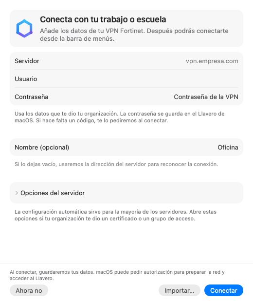
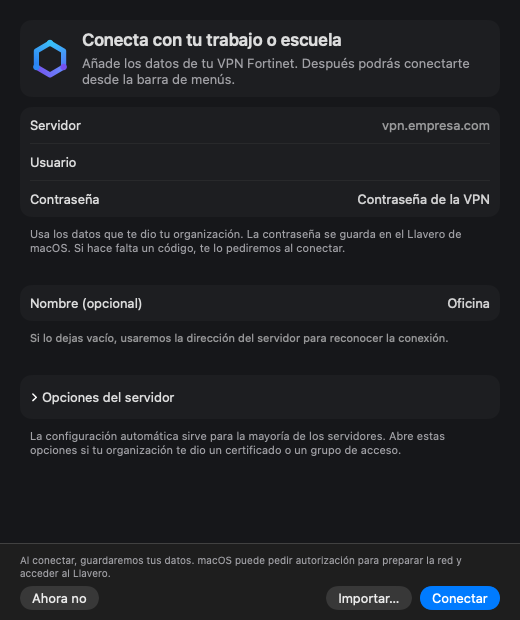

# Experiencia de usuario: revisión e implementación

Revisión y refinamiento del 28–29 de octubre de 2026. No se instaló, publicó ni
distribuyó una versión. La prueba VPN autorizada se realizó con la copia
instalada, 3.3.0 (159); los cambios locales se comprobaron por separado.

## Dirección y fundamentos

Nuvex se organiza alrededor de tres tareas: añadir una conexión, conectarse y
recuperarse de un problema. La configuración avanzada conserva sus capacidades,
pero deja de ser una condición para entender el uso cotidiano.

Se consultaron las referencias oficiales de Apple sobre
[primer uso](https://developer.apple.com/design/human-interface-guidelines/onboarding),
[configuración](https://developer.apple.com/design/human-interface-guidelines/settings),
[respuesta de la interfaz](https://developer.apple.com/design/human-interface-guidelines/feedback),
[accesibilidad](https://developer.apple.com/design/human-interface-guidelines/accessibility)
y [materiales](https://developer.apple.com/design/human-interface-guidelines/materials).
Las decisiones derivadas son: valores predeterminados fiables, ayuda junto a la
tarea, estado y recuperación en contexto, controles nativos y opciones que se
revelan cuando hacen falta. No se añadieron dependencias ni cambios de esquema.

## Vistas de referencia

| Primer uso en claro | Primer uso en oscuro |
| --- | --- |
|  |  |

| Panel en claro | Panel en oscuro |
| --- | --- |
|  |  |

## Fricciones y resolución por flujo

| Tarea | Fricción comprobada en el código anterior | Dirección e implementación |
| --- | --- | --- |
| Añadir la primera conexión | Portada y lista de pasos obligatorias antes del formulario; nombre requerido; elección de TLS expuesta desde el inicio | Formulario directo. Solo servidor, usuario y contraseña indispensables. Nombre automático a partir del servidor válido. Importación como alternativa junto a Conectar; esa acción guarda, prepara e inicia sin un segundo clic |
| Usar un servidor con requisitos especiales | La bienvenida no permitía huella ni realm y remitía a otra pantalla antes de conectar | `OpcionesServidor` compartido con Ajustes: certificado, huella, grupo de acceso, rutas y DNS disponibles en el mismo flujo. Se abre si ya hay personalización |
| Entender un guardado parcial | La bienvenida miraba cambios de un indicador global y la existencia del perfil; podía anunciar preparación completa sin todos los requisitos | `BorradorBienvenida` consume `ResultadoGuardado` de esa solicitud. Si falla la contraseña conserva los datos y no encadena una autorización del ayudante. Si falla el ayudante, detiene la secuencia. Si todo se prepara, conecta automáticamente y mantiene el resultado en la misma ventana; una conexión ya completada no vuelve a tratarse como primer uso pendiente al desconectarse después |
| Recuperar lo escrito | Reabrir la bienvenida recreaba todos sus estados | Borrador en memoria durante la sesión, incluido un guardado en curso. No se persisten contraseñas fuera del Llavero |
| Conectar y desconectar | Acciones implícitas en círculos; clic sobre el nombre para detalles; sin protección suficiente frente a desconexiones duplicadas | Acciones textuales, detalles mediante botón accesible y atajos conservados. Panel de 360 pt y estado a 12 pt para sostener legibilidad con las nuevas acciones. Estado de desconexión en curso y confirmación con una respuesta válida del motor |
| Saber si sigue conectado | Una consulta fallida dejaba visible el estado previo como si fuera actual | Panel y Ajustes muestran Estado sin comprobar y ofrecen consultar de nuevo. La conexión no se inicia usando un estado conocido como fallido |
| Recuperar una caída | Aviso y reconexión únicamente manual | Opción de un intento automático ejecutado, desactivada por defecto. La espera no consume el intento si la red vuelve a fallar. Espera cancelable de tres segundos, red disponible, perfil vigente y permisos existentes. Sin bucles ni conexión al arrancar |
| Completar un código | La ventana existente podía quedar detrás de otras y el panel solo permitía cancelar | Código… trae al frente la misma solicitud. Cancelación neutral; vencimiento de la espera comunicado como fallo recuperable |
| Activar lectura de Gmail | Copiar ID y secreto; selector desactivado de lectura en perfiles sin cuenta | Importar JSON de cliente de escritorio, conservar entrada manual y explicar que es opcional. Acceso directo desde la conexión para configurar Gmail. Reemplazar una sesión configurada requiere confirmación |
| Usar asistentes | Rutas y comandos en el recorrido normal aunque ya existía una acción de configuración integrada | Se conserva Configurar y su alcance; comandos y diagnóstico bajo desplegables, con revocación y exclusiones visibles |
| Proteger los datos | Un fallo de carga no era una precondición explícita del guardado | Se bloquea modificar perfiles hasta poder leerlos. Se evitan cargas simultáneas y cargas durante guardados |
| Reabrir Nuvex | Una app de barra de menús puede estar funcionando sin una ventana visible | Reabrir recupera primero el código o borrador pendiente; después prioriza una conexión con error, en curso o activa. No inicia una VPN por el mero hecho de abrir la app |

## Qué se resuelve automáticamente

- El nombre de una conexión nueva puede derivarse del servidor válido. Un nombre
  escrito, un perfil existente y una importación conservan su validación.
- El servidor admite su puerto predeterminado sin pedirlo por separado. Se
  conservan rutas y DNS habilitados de serie y la verificación del sistema.
- Se reutilizan ayudante y autorizaciones vigentes. No se vuelve a configurar
  Google por un error local del Llavero ni se amplían permisos de asistentes.
- Una recuperación consentida emplea el Llavero sin interacción. Si no puede
  leer la contraseña, solicita una acción manual en vez de mostrar un diálogo
  automático o reintentar indefinidamente.
- Los avisos de operaciones rutinarias de asistentes están desactivados de
  serie. Una elección explícita anterior se conserva; el panel sigue mostrando
  el estado y los fallos importantes permanecen visibles.
- La cuenta de Google puede prepararse a partir del JSON, sin copiar secretos.
  Su importación no concede acceso al correo.
- Los resultados y respuestas tardías se vinculan a la operación o al intento
  correspondiente. Un resultado antiguo no reemplaza otro intento posterior.

## Intervenciones que siguen siendo necesarias

| Intervención | Motivo |
| --- | --- |
| Servidor, usuario y contraseña | Nuvex no conoce las credenciales ni el servidor de cada organización |
| Certificado incluido, huella o grupo especial | No se puede inferir confianza ni pertenencia de forma segura |
| Autorizar el ayudante y, cuando corresponda, el Llavero o Touch ID | Son controles de macOS; Nuvex explica el propósito y reutiliza decisiones válidas |
| Crear un cliente propio e iniciar sesión en Google | Requisito del servicio actual. No hay un cliente compartido o verificado incluido; Google debe conceder el permiso de lectura |
| Elegir lectura de Gmail por conexión | Evita activar acceso sensible solo por tener una cuenta guardada |
| Activar recuperación, avisos, inicio de sesión o asistentes | Son decisiones independientes de la persona; se conservan políticas y exclusiones existentes |
| Desconectar túneles antes de cambiar perfiles que requieren actualizar el ayudante | Restricción de integridad y compatibilidad del motor existente |
| Eliminar, olvidar una cuenta, reemplazar una sesión o exportar contraseñas | Consecuencias importantes que conservan protección o confirmación |

## Verificación de la primera etapa

- Compilación SwiftPM de depuración y compilación completa del paquete local
  mediante `Nuvex/build.sh`, con firma ad hoc para no utilizar una identidad de
  publicación. El paquete solo se generó dentro del repositorio.
- 42 pruebas de Python: configuración, ayudante y OTP simulados, metadatos de
  actualización, versiones y comprobador de estado. Sin servidores VPN reales.
- Pruebas Swift y shell de interfaz, configuración, correo, preferencias de
  seguridad, núcleo, exportación, iconos, autorización de agentes, control,
  ciclo de app, publicación y versiones; prueba de actualización firmada.
- Regresiones añadidas: nombre automático y preservación del nombre escrito,
  rechazo de servidores inválidos, IPv6 y límite del nombre; presupuesto de
  recuperación; guardado parcial y contraseña conservada; resultados de otra
  operación que no acreditan éxito; cliente Google de escritorio válido y
  rechazo de archivos web, truncados, vacíos o con campos inválidos; avisos de
  asistentes silenciosos de serie con conservación de preferencias explícitas.
- Prueba de actualización E2E con servidor local y claves efímeras: instalación
  válida, fallo de red y firma inválida; se conserva la versión anterior cuando
  corresponde. Solo usa copias temporales, sin cambiar `/Applications`.
- Revisión del diff y comprobación de espacios con `git diff --check`.
- Capturas nativas con modelos ficticios en `.build-cache/capturas-ux/`.
  Incluyen primer uso, opciones especiales, error de guardado, preparación
  completa y pendiente, panel, estado desconocido, código, Google, asistentes y
  Ajustes a 780 × 580 y 1180 × 820, en claro y oscuro.

Los servicios de cuenta y permisos usan sustitutos de muestra durante las
capturas. No leen contraseñas reales ni ejecutan el diagnóstico del comando
instalado. El material se representa mediante su respaldo, no mediante la
composición de vidrio de una ventana interactiva. Los avisos de XPC de AppKit
en el renderizado y las advertencias de caché/deprecación de SwiftPM no impidieron
la compilación ni la generación de imágenes.

## Verificación del refinamiento

### Código y componentes locales

- Compilación de depuración y del paquete local, sin instalarlo. En esta etapa
  pasaron 42 pruebas de Python y las suites de interfaz, configuración, núcleo,
  seguridad, iconos y componentes de ventana.
- Regresiones de configuración: avance conservado; contraseña existente
  reutilizada solo si se conoce su disponibilidad; cancelación o fallo del
  ayudante que impide continuar automáticamente; preparación completa que permite
  pasar a conectar.
- Regresiones de interfaz: prioridad de reapertura, perfiles ocultos excluidos,
  recuperación aplazada sin consumir el intento y contraste AA de los textos
  informativos sobre las cuatro superficies opacas en claro y oscuro.
- `tests/test_interaccion.sh`: ventana de muestra, foco editable inicial, Tab
  entre campos, Retorno que valida y Escape que solicita cerrar. Se envían eventos
  locales exclusivamente a esa ventana. No es una prueba humana ni una prueba
  completa de navegación o VoiceOver.
- Capturas actualizadas: formulario con Conectar, progreso cancelable, conexión
  confirmada, permiso pendiente y rechazo de autenticación con Revisar datos.
  Inspección visual en claro y oscuro, sin considerarla interacción real.
- El foco del campo del código respeta Reducir movimiento. La etiqueta accesible
  de la barra no anuncia como conectada una VPN cuyo estado no se pudo comprobar.

Durante el desarrollo se ejecutó accidentalmente un binario anterior después de
una compilación fallida del verificador. Se detuvo exclusivamente ese proceso y
se comprobó que la app instalada seguía respondiendo y conservaba su conexión.
El script definitivo usa `set -euo pipefail` y solo ejecuta el verificador si la
compilación termina correctamente.

### Comprobaciones reales con la copia instalada

Con autorización explícita se ejecutó la desconexión y reconexión de la VPN
que ya estaba activa, dejando de nuevo esa conexión activa. El comando oficial
confirmó, por separado:

1. Resultado de desconexión con código cero y estado desconectada.
2. Solicitud real de código de verificación, lectura desde Gmail y resultado
   final conectado con código cero.
3. Diagnóstico sin diálogos: control, ayudante, política, confirmación inicial,
   firma, metadatos del Llavero y perfiles disponibles.

No se conservaron en Git ni en este documento el servidor, usuario, dirección
interna, remitente o código. Esta prueba acredita el túnel y la integración actual
con Gmail en la copia instalada. No acredita el flujo nuevo de la compilación
local ni acceso a un recurso interno: no se recibió un host y puerto autorizado.
Tampoco prueba permisos revocados; se reutilizaron las autorizaciones existentes.

### Límites observados del entorno

El sondeo sin solicitar permisos informó: acceso de Accesibilidad no concedido,
captura de pantalla no concedida, VoiceOver desactivado y preferencias de reducción
de movimiento, transparencia y aumento de contraste desactivadas. No se activó
ninguna de esas opciones. No se suspendió la Mac ni se cambió su red: esas acciones
afectan el equipo y requieren coordinación presencial.

## Revisión antes del commit — 29 de octubre de 2026

La revisión encontró y corrigió dos casos de cancelación:

- La espera de recuperación no contaba como conexión en curso para Terminal.
  Una petición de desconexión podía responder que ya estaba desconectada y dejar
  el reintento pendiente. Ahora la espera es cancelable por ambas interfaces y
  cancelar elimina la caída pendiente, evitando que otra actualización de red
  vuelva a programarla.
- Al cancelar después de terminar el proceso de conexión, faltaba aplicar la
  misma protección contra consultas antiguas que al desconectar. Ambas rutas
  comparten la aplicación de un estado de detención confirmado; durante su
  comprobación se bloquean órdenes de cancelación duplicadas.

Las regresiones usan modelos y respuestas ficticias: reconocen la espera como
operación en curso, la cancelan, simulan pérdida y recuperación de disponibilidad
de red y comprueban que no se reprograme. También rechazan confirmaciones ausentes,
fallidas o sin el perfil y solo actualizan el estado con una detención confirmada.
No sustituyen una interrupción física de red ni un servidor real.

Pasaron la compilación de depuración, la compilación completa local con firma
ad hoc, 42 pruebas de Python y las 15 suites Swift/shell, incluidas actualizaciones
firmadas y E2E sobre copias temporales. `git diff --check` no encontró errores.
Se revisaron nuevamente los renderizados de primer uso y panel; siguen siendo
muestras, no validación interactiva. No se instaló ni publicó una versión.

## Matriz y límites de validación

| Escenario | Evidencia disponible | Pendiente |
| --- | --- | --- |
| Primer inicio | Resultados y fallos probados; componentes con eventos locales; renderizados | Recorrido humano con datos reales en la compilación local |
| Uso habitual | VPN real desconectada y reconectada en la copia instalada | Acceso a recurso interno autorizado y convivencia de varias VPN |
| Permisos existentes | Reconexión y lectura real de Gmail satisfactorias; diagnóstico instalado correcto | Administrador, Touch ID, Llavero bloqueado/revocado y permisos de una instalación nueva |
| Fallos y lentitud | Regresiones y estados de error/cancelación; espera de recuperación que no consume el intento | Servidor caído, cancelación real durante OTP y red interrumpida en la compilación local |
| Cierre y reapertura | Prioridad probada y borrador fuera de la vista | Cerrar/reabrir físicamente cada ventana con la compilación local |
| Reposo y red | Observadores existentes y regresión de presupuesto | Reposo/despertar y cambio de red físicos |
| Claro y oscuro | Renderizados inspeccionados y contraste de paleta probado | Vidrio compuesto en ventana activa/inactiva y otras pantallas |
| Teclado y VoiceOver | Eventos locales de foco, Tab, Retorno y Escape; etiquetas revisadas | Recorrido completo con teclado, Acceso total con teclado y VoiceOver real |
| Preferencias de accesibilidad | Adaptación revisada en código y transición de foco corregida | Reducir movimiento/transparencia, Aumentar contraste y tamaño de texto en ventana real |

## Comprobaciones breves que requieren a la persona

Para validar la compilación nueva sin instalarla, en un momento en que puedas
interrumpir el trabajo, sal de la copia instalada y abre el paquete local
`Nuvex/Nuvex.app` desde Finder. Evita ejecutar ambas copias simultáneamente.
Al terminar, sal de la copia local y vuelve a abrir `/Applications/Nuvex.app`.
La firma local ad hoc puede hacer que macOS solicite acceso al Llavero. Para
añadir un perfil nuevo, primero desconecta las VPN activas: el motor lo exige
para actualizar el ayudante.

1. **Primer uso:** abre Añadir conexión, recorre los campos con Tab y pulsa
   Retorno vacío: debe avisar y enfocar el dato faltante. Introduce un perfil
   autorizado y pulsa Conectar una vez. Cancela un permiso cuando aparezca:
   debe conservar el avance sin repetirlo. Reabre y continúa cuando quieras.
2. **Reapertura:** cierra la ventana durante un intento o error y vuelve a abrir
   Nuvex desde Finder. Debe recuperar el código/borrador pendiente o mostrar la
   conexión relevante. Cerrar la ventana no cancela; Cancelar sí detiene el intento.
3. **VoiceOver y teclado:** activa VoiceOver con ⌘F5 y, si hace falta, Acceso total
   con teclado. Recorre campos, opciones, botones y detalles; deben anunciar nombre,
   estado y acción. Con el menú abierto, comprueba ⌘1–⌘9; en Ajustes, ⌘, y ⌘S;
   en el formulario, Retorno y Escape; ⌘W debe cerrar la ventana.
4. **Apariencia:** cambia a claro/oscuro y alterna Reducir movimiento, Reducir
   transparencia y Aumentar contraste en Accesibilidad › Pantalla. Comprueba foco,
   legibilidad, menús y progreso; restaura después tus preferencias.
5. **Red y reposo:** con una VPN autorizada y guardando tu trabajo, activa la
   recuperación opcional, interrumpe/restaura la red y después prueba reposo y
   despertar. Debe mostrar el estado efectivo, permitir cancelar y ejecutar como
   máximo un intento automático. No debe conectar tras una desconexión voluntaria.
6. **Acceso interno:** proporciona un host y puerto sin credenciales para usar
   el comprobador de [validación en vivo](validacion-en-vivo.md). Un túnel activo
   por sí solo no demuestra acceso a ese servicio.

Gmail conserva su arquitectura y configuración actual. La alternativa de un
cliente OAuth de Nuvex se documenta en [una propuesta separada](gmail-cliente-nuvex.md),
sin implementación ni servicios externos.

No se afirma una prueba de usabilidad con personas. Las versiones mínimas de
macOS 14/15 siguen pendientes de comprobación.
